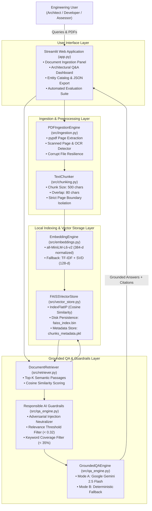
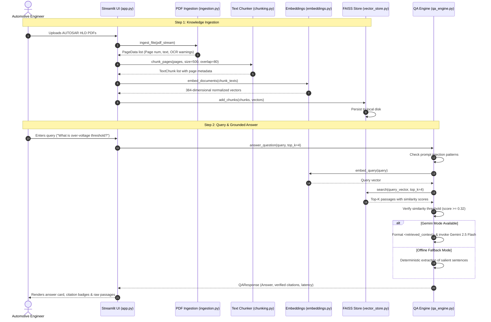
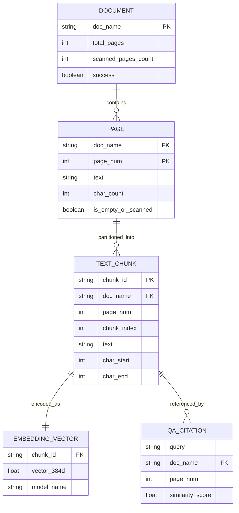

# System Architecture and Processing Workflow
**TechPulse FY-26 Applied AI/ML Capstone — Case Study 1 (CS1)**  
**Project:** AUTOSAR HLD Document Analysis Assistant  

---

## 1. High-Level Logical Architecture

---

## 2. Ingestion & Retrieval Sequence Diagram

---

## 3. Data Flow and Entity Relations

